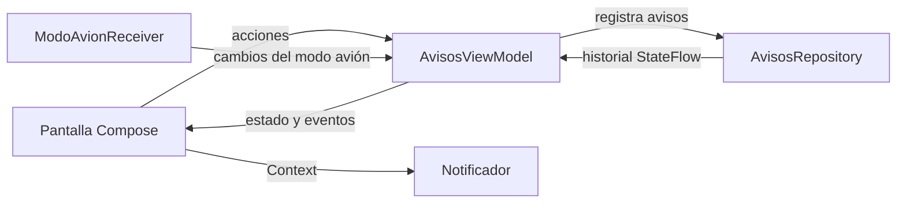
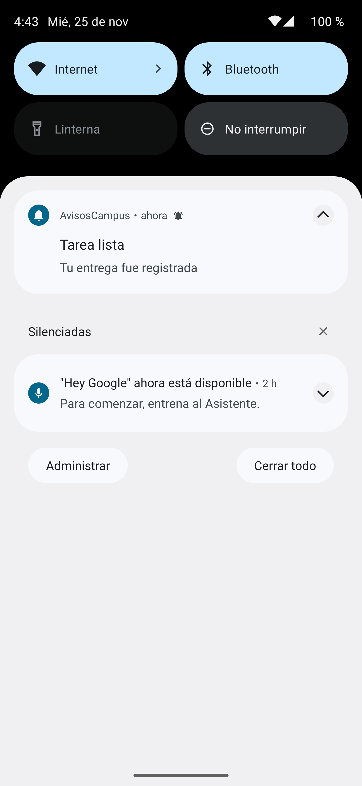
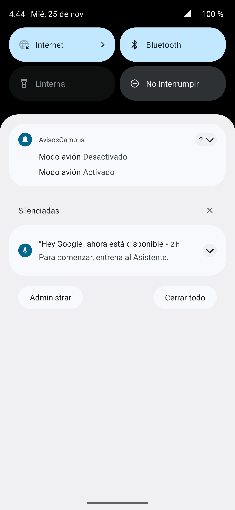
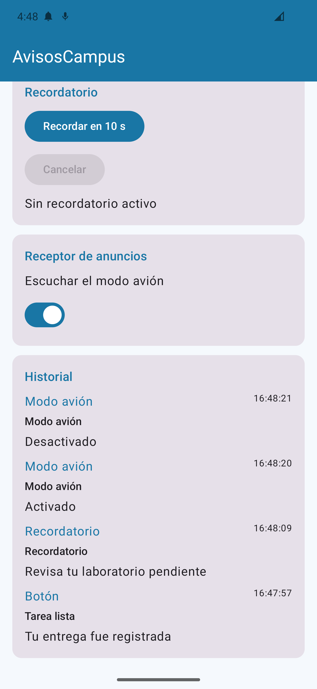
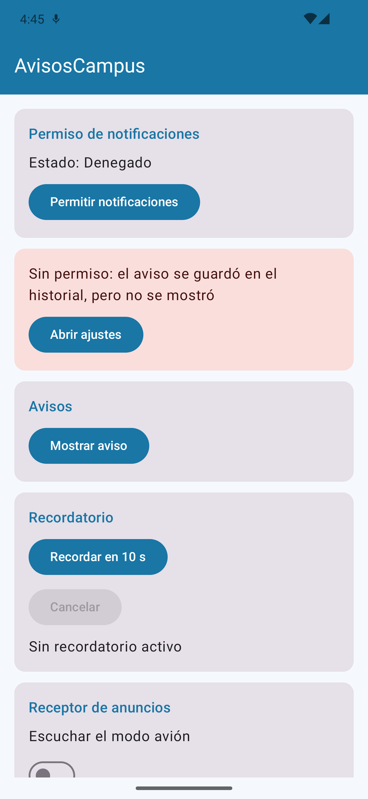
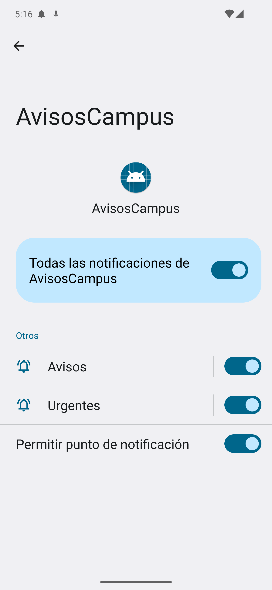
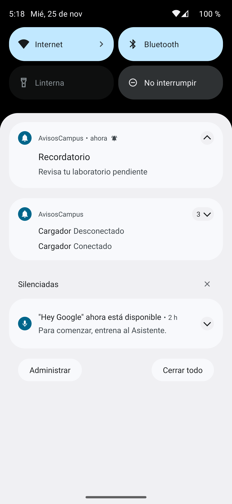
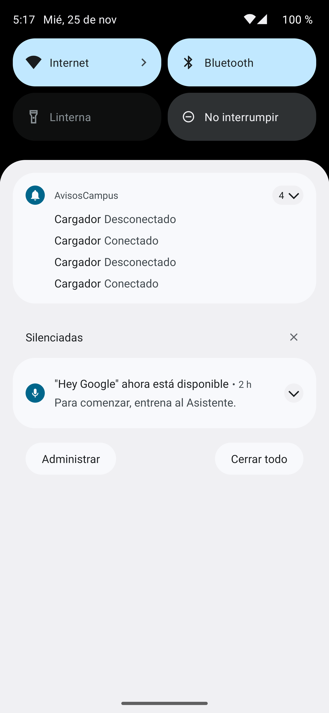

# AvisosCampus

Aplicación Android hecha con Kotlin y Jetpack Compose para crear notificaciones locales, programar recordatorios, escuchar cambios del modo avión y consultar un historial de avisos.

## Estructura de paquetes

```text
com.tecsup.avisoscampus/
├── AvisosApp.kt
├── MainActivity.kt
├── data/
│   └── AvisosRepository.kt
├── model/
│   └── Modelos.kt
├── notificacion/
│   └── Notificador.kt
├── receiver/
│   └── ModoAvionReceiver.kt
├── ui/
│   ├── HistorialAvisos.kt
│   ├── PantallaAvisos.kt
│   └── theme/
└── viewmodel/
    ├── AvisosViewModel.kt
    └── AvisosViewModelFactory.kt
```

## Diagrama MVVM + Repository



## Evidencias

Capturas tomadas en el emulador Pixel 6 Pro con Android 13 (API 33).

### 1. Notificación en el panel



### 2. Recordatorio


### 3. Avisos por cambio del modo avión



### 4. Historial de avisos



### 5. Permiso denegado



## Mejoras de la Fase 2

### 1. Canales de notificación Avisos y Urgentes



### 2. Notificación expandida con BigTextStyle



### 3. Avisos al conectar y desconectar el cargador



## Respuestas: Para pensar

1. **¿Por qué una notificación necesita un canal y un permiso? ¿Qué pasa si falta cada uno?**  
   Desde Android 8, las notificaciones deben pertenecer a un canal para que se puedan configurar. Desde Android 13, la app también necesita el permiso `POST_NOTIFICATIONS`. Sin permiso no se muestra la notificación; sin canal, no se puede publicar en las versiones que lo requieren.

2. **¿Por qué el ViewModel emite un evento y no muestra la notificación él mismo?**  
   Mostrarla requiere `Context` de Android. El ViewModel emite el evento y la pantalla, que sí tiene `Context`, llama al Notificador.

3. **¿Qué pasa si usas el mismo id en dos notificaciones?**  
   Android actualiza o reemplaza la notificación anterior con ese id. El Repository asigna un id creciente para que cada aviso se muestre por separado.

4. **¿Por qué `onReceive` debe ser corto y por qué hay que quitar el receptor al salir?**  
   `onReceive` se ejecuta en el hilo principal, por eso debe terminar rápido. La pantalla quita el receptor al salir para que deje de escuchar y no conserve referencias innecesarias.

5. **¿En qué casos usarías una notificación local y en cuáles una push de Firebase?**  
   Una notificación local sirve para eventos que decide el dispositivo, como un recordatorio. Una push de Firebase sirve cuando un servidor debe avisar de un evento, como un mensaje nuevo.
